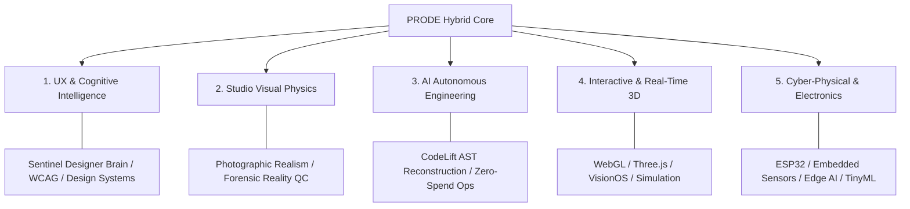

# PRODE (Product Design & Engineering)
### Canonical Blueprint for an AI-Native Product Engineering & Interactive Technology Company

```
   ██████╗ ██████╗  ██████╗ ██████╗ ███████╗
   ██╔══██╗██╔══██╗██╔═══██╗██╔══██╗██╔════╝
   ██████╔╝██████╔╝██║   ██║██║  ██║█████╗  
   ██╔═══╝ ██╔══██╗██║   ██║██║  ██║██╔══╝  
   ██║     ██║  ██║╚██████╔╝██████╔╝███████╗
   ╚═╝     ╚═╝  ╚═╝ ╚═════╝ ╚═════╝ ╚══════╝
   AI-NATIVE PRODUCT ENGINEERING & INTERACTIVE TECH
```

---

## 1. Executive Summary

**PRODE** is the foundational strategic and operational blueprint for building an **AI-Native Product Engineering & Interactive Technology Company**. 

Rather than conforming to traditional agency or venture stereotypes—such as pure-play SaaS startups, isolated Figma design houses, or capital-intensive game studios—PRODE articulates a **synthesized cyber-physical product engineering model**. 

PRODE defines how a multidisciplinary founder with an **Electronic Engineering foundation, systemic UX/UI intelligence, physical visual realism mastery, and autonomous software capabilities** executes high-value product development. It establishes the organizational architecture, commercial engines, operating procedures, and technical lifecycles needed to take a complex problem from raw discovery into working web applications, real-time spatial experiences, and edge hardware products.

While **[ZaxterLab](https://github.com/zakshub/zaxterlab)** acts as the digital multi-agent execution runtime, **PRODE** serves as the authoritative strategic blueprint and company constitution governing *what* to build, *why* to build it, and *how* to govern commercial operations.

---

## 2. Core Pillars & Unfair Advantages



1. **UX/UI & Cognitive Architecture:** Grounded in W3C accessibility, state machine mechanics, and responsive design systems via canonical intelligence (`zakshub/designer`).
2. **Photographic & Cinematic Production:** Asset generation strictly governed by physical causality (shadow $\leftarrow$ light, fold $\leftarrow$ gravity, camera optics) via (`zakshub/studio`).
3. **AI-Native Autonomous Software:** Reliable AST code generation, dependency compilation, and zero-defect validation gates via (`zakshub/codelift`).
4. **Interactive & Spatial Technologies:** Real-time 3D, WebGL shaders, camera motion pipelines, and spatial computing interfaces (`zakshub/bob`, `zakshub/multarc`).
5. **Cyber-Physical Systems & Electronics:** Direct bridging of software into physical reality using Electronic Engineering fundamentals, microcontrollers (ESP32/ARM), sensor telemetry, and edge machine learning.

---

## 3. Repository Documentation Map

All strategic, operational, and technical frameworks are systematically documented in [`docs/`](./docs/):

| Document | Purpose & Scope |
| :--- | :--- |
| **[`01_COMPANY_IDENTITY.md`](./docs/01_COMPANY_IDENTITY.md)** | Mission, vision, core values, positioning quadrant, and the "Synthesist" thesis. |
| **[`02_BUSINESS_MODEL.md`](./docs/02_BUSINESS_MODEL.md)** | The 3 complementary revenue paths (Client Services, Productized Packages, Owned SaaS/IP). |
| **[`03_MARKET_STRATEGY.md`](./docs/03_MARKET_STRATEGY.md)** | Target customer archetypes, problem validation pipelines, competitive moats. |
| **[`04_ORGANIZATION_AND_ROLES.md`](./docs/04_ORGANIZATION_AND_ROLES.md)** | 9 core functional departments, 36 specialist roles, RACI matrix, human authority boundaries. |
| **[`05_AI_WORKFORCE_ARCHITECTURE.md`](./docs/05_AI_WORKFORCE_ARCHITECTURE.md)** | Multi-agent cognitive mesh, specialist capabilities, review loops, ZaxterLab bridge. |
| **[`06_OPERATING_PROCEDURES.md`](./docs/06_OPERATING_PROCEDURES.md)** | Standard operating procedures: Lead-to-Contract, Contract-to-Delivery, QA gates, release. |
| **[`07_PRODUCT_ENGINEERING_FRAMEWORK.md`](./docs/07_PRODUCT_ENGINEERING_FRAMEWORK.md)** | 6-phase engineering lifecycle from Discovery to CodeLift compilation and deployment. |
| **[`08_CYBER_PHYSICAL_ROADMAP.md`](./docs/08_CYBER_PHYSICAL_ROADMAP.md)** | Roadmap for electronics, digital twins, IoT telemetry, TinyML, and robotics interaction. |
| **[`09_KNOWLEDGE_AND_ARTIFACTS.md`](./docs/09_KNOWLEDGE_AND_ARTIFACTS.md)** | Artifact retention, evidence-backed records, decision logging, and intellectual property. |
| **[`10_FINANCIAL_AND_RISK_CONTROLS.md`](./docs/10_FINANCIAL_AND_RISK_CONTROLS.md)** | Zero-spend default boundaries, spend limits, client data isolation, security guardrails. |
| **[`11_IMPLEMENTATION_ROADMAP.md`](./docs/11_IMPLEMENTATION_ROADMAP.md)** | Phased commercial progression from boutique studio to spatial & cyber-physical leader. |

---

## 4. Schemas & Templates

* **[`schemas/role_taxonomy.json`](./schemas/role_taxonomy.json)**: Machine-readable role hierarchy and departmental mapping.
* **[`schemas/project_manifest_schema.json`](./schemas/project_manifest_schema.json)**: JSON schema validating client engagements and internal ventures.
* **[`templates/proposal_template.md`](./templates/proposal_template.md)**: Standardized Sprint Zero and Full-Lifecycle client proposal.
* **[`templates/prd_template.md`](./templates/prd_template.md)**: Product Requirement Document enforcing Designer-Studio contract compliance.
* **[`templates/forensic_qc_checklist.md`](./templates/forensic_qc_checklist.md)**: Rigorous dual-gate checklist for physical reality and code compilation.

---

## 5. Sovereign Authority & Governance

1. **Zak is the Sovereign Decision-Maker:** All commercial commitments, intellectual property transfers, capital spending, and production releases require explicit owner sign-off.
2. **Zero-Spend Financial Default:** Infrastructure, API integrations, and cloud resources operate under a strict zero-authorized spend boundary until backed by client revenue or formal allocation.
3. **Evidence-Driven Engineering:** No software is committed without AST validation and test compilation. No visual asset is accepted without passing physical causality review.

---

## 6. License & Status

* **Status:** Canonical Strategic Blueprint (Active)
* **Author:** Zak (`zakshub`)
* **Operating Runtime:** Integrated with [ZaxterLab](https://github.com/zakshub/zaxterlab)
