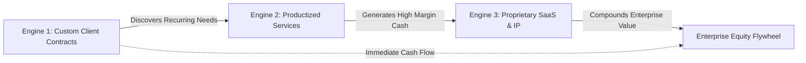

# 02. Business Model & Revenue Engine

## 1. The Three Complementary Revenue Engines

PRODE employs a tri-tiered business model designed to maximize immediate cash flow, protect operational margins, and compound long-term enterprise equity.

---

### Engine 1: High-Ticket Custom Innovation Contracts (Near-Term Cash Flow)

**Purpose:** Generate strong upfront cash flow, fund company operations, and expose the team to real enterprise problems.

#### Offering Tiers
1. **Sprint Zero — Discovery & System Architecture ($5,000 – $15,000 | 1–2 Weeks):**
   * *Deliverables:* Technical architecture specification, interactive Figma/HTML prototype, database schema, feasibility analysis, and fixed-price implementation quote.
   * *Purpose:* Eliminates project ambiguity, qualifies serious clients, and pays for the initial research and scoping phases.
2. **End-to-End Full Lifecycle Builds ($25,000 – $120,000+ | 4–12 Weeks):**
   * *Deliverables:* Production web application, WebGL interactive experience, or edge IoT device firmware. Includes automated CI/CD pipeline, full test suite, and W3C WCAG accessibility certification.
   * *Billing:* 50% upfront, 25% at milestone verification, 25% upon final build acceptance.
3. **Strategic Technology Advisory & Fractional CTO ($5,000 – $12,000 / month):**
   * *Deliverables:* Weekly architectural oversight, agent system implementation, code reviews, and security audits for high-growth tech companies.

---

### Engine 2: Productized Services (Scalable Margin & Predictability)

**Purpose:** Decouple revenue from hourly labor by selling fixed-scope, highly automated deliverables powered by proprietary AI intelligence.

#### Standard Offerings
1. **Design-to-Code Reconstruction Engine (`codelift`):**
   * *Scope:* Convert complex Figma/React design system mockups into fully typed, responsive, build-verified React/Tailwind/Next.js codebases.
   * *Turnaround:* 72 hours.
   * *Pricing:* $3,500 – $8,500 per package.
2. **Cinematic 3D Web Experience Package (`bob`):**
   * *Scope:* Build high-performance Three.js/WebGL interactive product landing pages with camera motion planning, custom shaders, and mobile optimization.
   * *Turnaround:* 10 business days.
   * *Pricing:* $7,500 – $20,000 per experience.
3. **Market Feasibility & Demand Audit (`seo`):**
   * *Scope:* Data-backed market opportunity analysis evaluating 11-dimension candidate scores, search demand, competitor vulnerability, and target unit economics.
   * *Pricing:* $2,500 fixed fee.

---

### Engine 3: Proprietary SaaS & Spatial IP (Compounding Equity)

**Purpose:** Build recurring subscription revenue and enterprise asset value without external venture dependency.

#### Criteria for Launching a Proprietary Product
A problem must pass four strict gates before being approved as an internal venture:
1. **Observed Frequency:** The problem has been solved for at least three separate paying clients.
2. **Reusability:** At least 60% of the underlying codebase and logic can be abstracted into a multi-tenant platform.
3. **Zero Capital Risk:** The development cost is fully subsidized by client profits.
4. **Distribution Advantage:** Direct, verified access to target buyers without reliance on expensive paid advertising.

#### Candidate IP Vectors
* **Multi-Agent Governance Platform:** Commercializing the orchestration and spending-lock patterns developed in `zaxterlab` and `zedcu`.
* **Spatial Product Configurator Engine:** B2B SaaS platform allowing luxury brands to embed real-time 3D and AR viewers into existing e-commerce storefronts.
* **IoT Edge Telemetry Gateway:** Universal lightweight firmware and dashboard stack for industrial sensor fleets.

---

## 2. Customer Archetypes & Target Segments

| Archetype | Characteristics | Primary Pain Point | PRODE Solution |
| :--- | :--- | :--- | :--- |
| **Series A/B Startups** | Well-funded, moving fast, high engineering velocity demands. | Slow frontend hiring; poor design-to-engineering translation. | Rapid `codelift` frontend builds & interactive prototypes. |
| **Mid-Market Industrial & IoT** | Established manufacturing or physical product companies. | Outdated software interfaces; lack of modern cloud connectivity. | Cyber-physical telemetry dashboards and embedded firmware. |
| **Luxury & Consumer Brands** | High average order value (AOV), strong design focus. | Static 2D product catalogs that fail to engage modern consumers. | Cinematic WebGL 3D interactive product showcases (`bob`). |
| **Enterprise Innovation Labs** | Large enterprises exploring AI and spatial tech. | Internal inertia; inability to rapidly prototype experimental tech. | Sprint Zero architecture and working proof-of-concept builds. |

---

## 3. Financial Philosophy & Unit Economics

1. **Default Zero-Spend Operating Boundary:**
   * Fixed operational overhead is maintained near zero. All development and staging environments utilize free-tier or open-source infrastructure (`zedcu` paradigm).
   * Infrastructure scaling is tied strictly to client contract receipts.
2. **Target Profit Margins:**
   * Custom Engineering Services: **65% – 80% Gross Margin** (enabled by AI-native workflows).
   * Productized Services: **80% – 90% Gross Margin**.
   * Proprietary SaaS: **85%+ Gross Margin**.
3. **Cash Flow Discipline:**
   * Work never commences without a 50% deposit.
   * Releases and intellectual property transfers fail closed until 100% of milestone payments clear.
