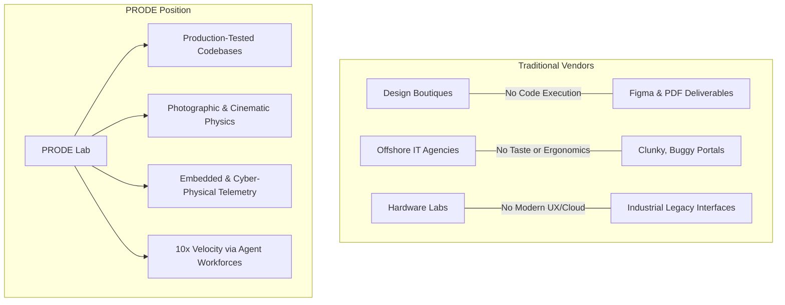

# 03. Market Strategy & Competitive Advantage

## 1. Market Opportunity Analysis

The global software development and design agency landscape is undergoing an unprecedented structural shift:
1. **The Collapse of Generic Outsourcing:** Low-tier coding farms and template-based web agencies are rapidly losing market share as AI tools democratize commodity code generation.
2. **The Rise of the "Full-Stack Synthesist":** High-value clients no longer want five disconnected vendors (a brand agency, a UX shop, a backend contractor, a 3D animator, and an embedded engineer). They demand cohesive teams capable of taking an idea through full realization across hardware, software, and spatial interfaces.
3. **The Demand for Verified Reality:** The proliferation of artificial, generic AI slop has created a premium demand for grounded, forensic-grade visual realism (`studio`) and verifiable, compiling code (`codelift`).

---

## 2. Competitive Positioning Matrix



### Direct Comparison Against Market Alternatives

| Feature / Metric | Traditional Dev Shop | High-End Design Agency | PRODE Hybrid Lab |
| :--- | :--- | :--- | :--- |
| **Output Deliverable** | Raw code (often poorly styled) | Figma files & mockups | Runnable, build-validated production software |
| **Visual Quality** | Generic Bootstrap/Tailwind | High aesthetic polish | Forensic reality (`studio`), zero hallucinated artifacts |
| **Technical Depth** | Software only | Frontend concept only | Cyber-physical: Web, 3D WebGL, Microcontrollers |
| **Turnaround Time** | 3 – 6 Months | 2 – 4 Months | 2 – 4 Weeks (AI-native leverage) |
| **Operational Cost** | High (large engineering headcount) | High (expensive agency overhead) | Ultra-lean (Zero-spend default, autonomous agents) |

---

## 3. Go-to-Market (GTM) Strategy

### Phase 1: High-Authority Proof of Execution (Months 1–6)
* **Open Source Strategic Assets:** Publish robust, real-world modules and intelligence libraries (such as `designer`, `studio`, and `codelift`) to establish undeniable technical authority.
* **Cinematic Case Studies:** Build and publicly demonstrate production-grade interactive WebGL experiences and cyber-physical prototypes.
* **Targeted Outreach:** Direct partner outreach to funded hardware startups and high-end design agencies needing reliable full-stack engineering execution.

### Phase 2: Inbound Engine & Productized Funnels (Months 6–12)
* **Automated Demand Capture:** Leverage the `zakshub/seo` engine to discover unserved search queries in technical niches (e.g., "Figma to Next.js AST converter", "real-time IoT WebGL dashboard").
* **Low-Friction Sprint Zero:** Convert qualified prospects using fixed-price, low-risk architectural audits before pitching multi-month full-lifecycle contracts.

### Phase 3: Ecosystem & Platform Flywheel (Months 12+)
* **Proprietary SaaS Spinouts:** Launch standalone tools originating from repeated client bottlenecks.
* **Enterprise Technology Licensing:** License internal modules (such as spatial configurators and multi-agent governance runtimes) to corporate partners.

---

## 4. Problem Validation Pipeline

Before committing engineering resources to any internal or client initiative, the project must be evaluated against the **PRODE 5-Point Validation Filter**:

```
[Problem Candidate]
       │
       ▼
1. Is the pain point economically severe? (Does it cost the client >$20k/yr in lost productivity?)
       │
       ▼
2. Can we achieve a 10x velocity advantage using our AI-native tooling?
       │
       ▼
3. Does the solution require a synthesis of design, software, or physical tech?
       │
       ▼
4. Does the project yield reusable IP or component assets for our long-term library?
       │
       ▼
5. Is the technical execution verified without speculative external spend?
       │
       ▼
[VALIDATED: Proceed to Sprint Zero]
```
