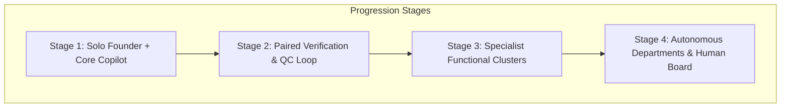
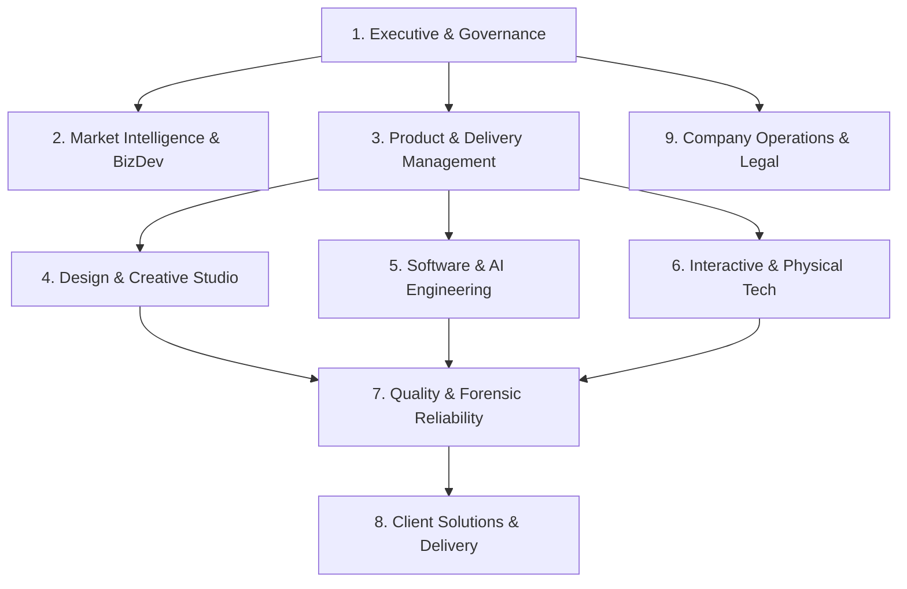

# 04. Organizational Structure & Role Taxonomy

## 1. Organizational Philosophy: Organic Scale vs. Swarm Vanity

PRODE adopts the organizational principle established in [ZaxterLab](https://github.com/zakshub/zaxterlab): **Organizations evolve organically as a function of measured workload, not architectural vanity.**

The 9 departments and 36 specialist roles defined below represent a **functional taxonomy of accountability**, not a day-one hiring mandate. In the early stages, one human founder (Zak) oversees key decisions while specialized AI agent roles are dynamically activated to execute discrete tasks.

---

## 2. Departmental Breakdown & Role Definitions

### Department 1: Executive & Governance
* **Founder & Chief Executive Officer (Zak):** Holds sovereign authority over strategy, major capital allocation, master client contracts, and final production releases.
* **Chief Technology Officer:** Oversees engineering architecture, security policies, and technical viability.
* **Chief Product Officer:** Preserves brand philosophy, UX standards, and product-market fit.
* **Governance & Audit Lead:** Enforces spending locks, compliance with operating constitutions, and risk policies.

### Department 2: Market Intelligence & Business Development
* **Market Demand Researcher (`seo`):** Monitors search queries, competitor gaps, and commercial demand trends.
* **Customer Discovery Analyst:** Conducts customer interviews and maps enterprise pain points.
* **Proposal & Solution Architect:** Drafts Sprint Zero proposals, technical scopes, and pricing estimates.
* **Partnership & Channel Specialist:** Manages agency partnerships and strategic referral networks.

### Department 3: Product & Delivery Management
* **Technical Product Manager:** Translates validated business problems into clear product roadmaps and sprint milestones.
* **Requirements & Acceptance Architect:** Formulates precise user stories and measurable acceptance criteria.
* **Sprint & Dependency Coordinator:** Tracks critical path blockers and resource allocation.
* **Release Manager:** Coordinates staging environments, smoke testing, and zero-downtime deployments.

### Department 4: Design & Creative Studio (Governed by `zakshub/designer` & `zakshub/studio`)
* **Lead UX Architect:** Defines user flows, mental models, state diagrams, and interaction hierarchies.
* **Design System Engineer:** Builds component libraries, responsive layout matrices, and typographic tokens.
* **Photographic Reality Director (`studio`):** Prompts and guides photographic visual assets using camera physics and lighting logic.
* **Motion & Micro-Interaction Designer:** Crafts fluid UI transitions, spring physics, and micro-delights.

### Department 5: Software & AI Engineering
* **Autonomous Systems Engineer:** Orchestrates multi-agent pipelines, LLM routing, and structured schemas.
* **Full-Stack Web Architect:** Engineers scalable web apps using Next.js, Node.js, TypeScript, PostgreSQL, and Prisma.
* **Frontend Reconstruction Specialist (`codelift`):** Converts UI prototypes into AST-parsed, compilable React components.
* **Backend & API Systems Engineer:** Implements secure REST/GraphQL endpoints, database indexing, and microservices.

### Department 6: Interactive & Physical Engineering (Hardware & 3D)
* **Real-Time 3D & WebGL Engineer (`bob`):** Develops Three.js scenes, custom shaders, and WebGPU graphics.
* **Spatial Computing Specialist:** Builds AR/VR experiences, Apple VisionOS spatial apps, and WebXR prototypes.
* **Embedded Firmware Engineer:** Programs ESP32 and ARM Cortex microcontrollers in C/C++ and FreeRTOS.
* **IoT & Sensor Fusion Architect:** Designs telemetry pipelines, MQTT brokers, and hardware sensor integration.

### Department 7: Quality, Security & Forensic Reliability
* **Forensic Reality QC Officer (`studio/qc`):** Audits imagery and 3D assets for physical causality violations.
* **Code Reliability Auditor (`codelift`):** Enforces build checks, unit test suites, and zero-defect compile gates.
* **Security & Penetration Tester:** Scans dependencies for CVEs, audits API authentication, and secures environment vaults.
* **Performance & Latency Benchmark Auditor:** Measures Core Web Vitals, 60 FPS graphics rendering, and firmware loop timing.

### Department 8: Client Solutions & Delivery
* **Solutions Architect:** Leads technical discovery meetings and maps client requirements to system architecture.
* **Technical Documentation Lead:** Authors comprehensive developer guides, API docs, and runbooks.
* **Client Handover & Training Specialist:** Delivers recorded walkthroughs, code repositories, and user training.
* **Ongoing Support & SLA Manager:** Monitors uptime, error telemetry, and post-release support.

### Department 9: Company Operations & Legal
* **Spend & Quota Controller (`zedcu`):** Enforces the default zero-spend boundary and audits cloud resource consumption.
* **IP & Contract Governance Lead:** Protects proprietary IP, handles client contracts, and oversees NDA compliance.

---

## 3. RACI Responsibility Matrix

| Milestone / Deliverable | Zak (Founder) | Product Mgr | Studio / Designer | Lead Engineer | Forensic QC |
| :--- | :---: | :---: | :---: | :---: | :---: |
| **Contract Approval & Scope** | **A** | R | C | C | I |
| **UX & Component System** | I | A | **R** | C | C |
| **Visual Assets & 3D Graphics** | I | C | **R** | I | A |
| **Production Code Compilation** | I | I | C | **R** | A |
| **Hardware / Firmware Build** | A | I | I | **R** | C |
| **Final Production Release** | **A** | C | I | I | C |

*Legend: **R** = Responsible, **A** = Accountable (Final Authority), **C** = Consulted, **I** = Informed.*

---

## 4. Human Authority & Approval Boundaries

To maintain absolute safety and operational integrity:
1. **Unbypassable Owner Gate:** AI agents or automated scripts can never sign legal contracts, commit financial expenditures, or publish production releases without Zak's explicit confirmation.
2. **Fail-Closed Principle:** If an automated verification step fails or encounters ambiguous requirements, the system halts execution and alerts the human operator.
