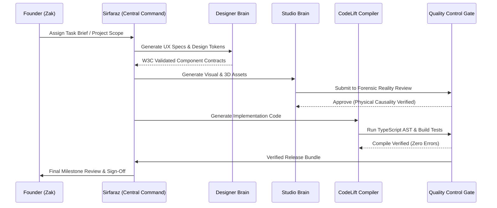

# 05. AI Workforce Architecture & Multi-Agent Mesh

## 1. The Multi-Agent Cognitive Mesh

PRODE does not treat AI as a conversational toy or a basic prompt box. AI is deployed as a **structured multi-agent engineering workforce** governed by strict contracts, typed schemas, and automated verification gates.

---

## 2. Integration with Canonical Systems

PRODE sits at the apex of Zak's canonical software intelligence ecosystem:

1. **[ZaxterLab](https://github.com/zakshub/zaxterlab) (Execution Engine):**
   * Acts as the runtime platform hosting dynamic worker sessions, ephemeral task queues, and tool orchestration.
   * PRODE supplies the strategic rules, role definitions, and business logic that ZaxterLab executes.
2. **[Sentinel Designer Brain](https://github.com/zakshub/designer) (UX/UI Intelligence):**
   * Directs all visual interface hierarchies, component state machines, accessibility checks, and brand rules.
   * Every web interface engineered in PRODE must conform to `designer` protocols.
3. **[Studio Visual Brain](https://github.com/zakshub/studio) (Asset Production):**
   * Governs photographic asset generation, anti-AI realism, camera optics, and material rendering.
   * Blocks artificial smoothing, hallucinated hands/textures, and ungrounded lighting.
4. **[CodeLift](https://github.com/zakshub/codelift) (Engineering Compiler):**
   * Analyzes, reconstructs, and validates TypeScript/React code before it touches the git repository.
5. **[ZEDCU](https://github.com/zakshub/zedcu) (Spend Boundaries & Command Paradigms):**
   * Supplies the zero-spend financial boundary rules, quota tracking, and checkpoint persistence.

---

## 3. Specialist Agent Archetypes & Permissions

Each specialist agent operates within a scoped sandbox with explicit read, write, and execute permissions:

| Agent Archetype | Domain & Tools | Allowed Actions | Hard Locks / Prohibitions |
| :--- | :--- | :--- | :--- |
| **Command (Sirfaraz)** | Workflow planning, task dispatch, progress audit | Decompose milestones, route tasks to specialists | Cannot push to `main` or authorize expenses |
| **UX Lead (Hania / Designer)** | Wireframes, accessibility, state diagrams | Generate design tokens, markdown specs, component contracts | Cannot write backend database migrations |
| **Visual Lead (Studio)** | Image generation, textures, 3D assets | Call verified image pipelines, perform forensic checks | Cannot make UI/UX or interaction decisions |
| **Code Engineer (Reem / CodeLift)** | TypeScript, React, Next.js, Node.js | Write code, run tests, build local artifacts | Code cannot be committed without build pass |
| **QC Auditor (Aroosh / Zaks)** | Linters, compilers, forensic checks | Reject ungrounded code, flag physical causality errors | Cannot bypass test failures or issue overrides |
| **Governance (Zara / Umer)** | Secret scanning, spend audit, permissions | Lock sessions, block unauthorized API calls | Cannot be silenced or disabled by other agents |

---

## 4. Human-in-the-Loop Checkpoints

To ensure enterprise-grade safety, three mandatory checkpoints require explicit human interaction from Zak:

1. **The Commercial Gate:** Any interaction involving client pricing, contract signatures, or formal proposal submissions.
2. **The Spend Gate:** Any task that requires provisioning paid infrastructure, premium API credits, or third-party licenses.
3. **The Deployment Gate:** Final merging into canonical `main` branches and triggering production client deployments.
