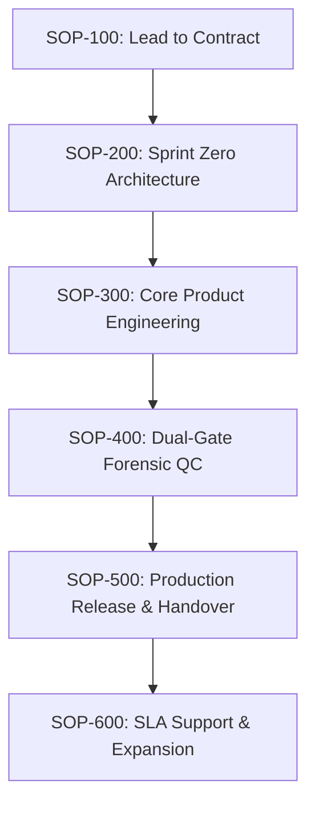

# 06. Standard Operating Procedures (SOPs)

## 1. Overview of Operating Lifecycles

PRODE maintains standardized, end-to-end operational procedures to ensure predictable delivery, rigorous quality control, and consistent client satisfaction.

---

## 2. Detailed SOP Specifications

### SOP-100: Lead to Contract
* **Trigger:** Inbound inquiry, referral, or outreach response.
* **Step 1 (Discovery Qualification):** Conduct a 30-minute structured discovery call. Evaluate the opportunity against the 5-Point Validation Filter.
* **Step 2 (Scope Formulation):** Identify if the client requires a full build or needs architectural de-risking. Default to proposing a **Sprint Zero** for projects with undefined technical scopes.
* **Step 3 (Proposal Generation):** Generate a standardized proposal using `templates/proposal_template.md`.
* **Step 4 (Contract & Deposit):** Issue a mutual NDA, master services agreement (MSA), and statement of work (SOW). Collect a **50% non-refundable upfront deposit**.

### SOP-200: Sprint Zero Architecture & De-Risking
* **Duration:** 1 to 2 Weeks.
* **Step 1 (Information Architecture):** Define user personas, journey maps, and system state machines.
* **Step 2 (UX/UI System Spec):** Create wireframes and component tokens conforming to `zakshub/designer`.
* **Step 3 (Technical Architecture):** Draft the system architecture diagram, database entity relationship diagrams (ERD), API specifications, and cloud infrastructure requirements.
* **Step 4 (Client Review):** Present the interactive prototype and architecture document. Issue a fixed-scope SOW for the full build phase.

### SOP-300: Core Product Engineering
* **Duration:** 2 to 8 Weeks (executed in 1-week sprint cycles).
* **Step 1 (Asset Pipeline):** Generate visual and 3D assets using `zakshub/studio` and `zakshub/bob`. Assets must pass forensic reality inspection before integration.
* **Step 2 (Component Engineering):** Generate typed, responsive React/Tailwind components using `zakshub/codelift`.
* **Step 3 (Backend & Database):** Implement APIs, schema migrations (Prisma/PostgreSQL), and background workers.
* **Step 4 (Hardware / Firmware Integration - If Applicable):** Compile embedded C/C++ firmware (ESP32/FreeRTOS), test sensor loop timings, and connect telemetry to cloud MQTT endpoints.

### SOP-400: Dual-Gate Forensic QC
* **Gate 1: Code Reliability & Security Gate (`codelift`):**
  * Automated TypeScript type-check (`tsc --noEmit`) passes with zero errors.
  * Linting and format checks pass.
  * Unit and integration test suites pass.
  * Secret scanning verifies zero credentials or private tokens are tracked.
* **Gate 2: Physical Causality & UX Gate (`studio` & `designer`):**
  * All imagery inspected for physical causality (lighting vectors, shadow direction, texture consistency).
  * All interface controls pass W3C WCAG AA accessibility contrast ratios.
  * WebGL frame rates hit 60 FPS on target mobile and desktop hardware.

### SOP-500: Production Release & Client Handover
* **Step 1 (Milestone Sign-Off):** Present working staging build to client. Collect remaining milestone balance (100% funds cleared).
* **Step 2 (Production Deployment):** Deploy to client production environment (Vercel, Cloudflare, AWS, or bare metal).
* **Step 3 (Asset Transfer):** Grant repository permissions, provide recorded video walkthroughs, and deliver documentation runbooks.

### SOP-600: Ongoing Support, SLA & Expansion
* **Step 1 (Telemetry Monitoring):** Track error rates, server latency, and uptime via automated monitoring.
* **Step 2 (Monthly Review):** Hold monthly strategic calls to review usage metrics and identify recurring needs that warrant additional build sprints or retainer extensions.
