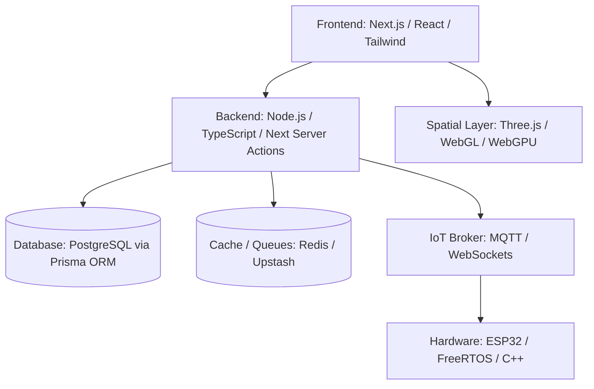
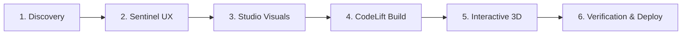

# 07. Product Engineering Framework

## 1. Technical Architecture & Tech Stack Matrix

PRODE maintains a standardized, high-performance technology stack optimized for reliability, rapid development velocity, and minimal operating costs.

### Approved Core Technology Stack

| Layer | Primary Technology | Secondary / Alternative | Justification |
| :--- | :--- | :--- | :--- |
| **Web Framework** | Next.js (App Router, TypeScript) | Vite + React SPA | Modern SSR/SSG, edge rendering, enterprise standard |
| **Styling & Design System** | Tailwind CSS + Radix UI Primitives | CSS Modules | Utility-first, zero runtime overhead, accessible primitives |
| **Interactive 3D / Spatial** | Three.js + React Three Fiber (R3F) | Babylon.js / WebGPU | Broad hardware compatibility, 60 FPS in-browser rendering |
| **Database & ORM** | PostgreSQL + Prisma ORM | Neon Serverless Postgres | Type-safe migrations, relations, zero data loss |
| **Embedded Hardware** | ESP32-S3 / C++ / FreeRTOS | STM32 / MicroPython | Low-cost Wi-Fi/BLE microcontrollers, high community support |
| **Telemetry & Protocols** | MQTT / WebSockets / gRPC | REST / JSON | Sub-50ms latency for cyber-physical IoT telemetry |
| **Deployment / Edge** | Cloudflare Pages / Vercel / Render | AWS / Docker | Free tier friendly, global edge distribution, zero cold starts |

---

## 2. Six-Phase Engineering Lifecycle

### Phase 1: Problem Discovery & Grounding
* **Input:** Client requirements or internal market hypothesis.
* **Activities:** Problem decomposition, domain research, and database entity mapping.
* **Artifact:** Product Requirement Document (PRD) generated via `templates/prd_template.md`.

### Phase 2: Sentinel UX Architecture (`zakshub/designer`)
* **Input:** Approved PRD.
* **Activities:** Define interactive user flows, wireframes, and design system tokens.
* **Enforcement:** Compliance with W3C WCAG accessibility standards (contrast ratios, keyboard navigation, aria labels).
* **Artifact:** Interactive system prototype and design token manifest.

### Phase 3: Visual Identity & Asset Generation (`zakshub/studio`)
* **Input:** Wireframes and aesthetic brief.
* **Activities:** Synthesize photographic visuals, textures, and product renders using anti-AI realism protocols.
* **Enforcement:** Forensic causality verification (optics, light source vectors, material behavior).
* **Artifact:** Production-ready visual asset bundle.

### Phase 4: Code Reconstruction & Implementation (`zakshub/codelift`)
* **Input:** UX design tokens and functional specifications.
* **Activities:**
  1. AST-based component reconstruction.
  2. Full-stack implementation (frontend UI, API endpoints, Prisma schemas).
  3. Strict static analysis and unit testing.
* **Artifact:** Fully compiling Next.js/React codebase with zero build warnings.

### Phase 5: Interactive 3D & Cyber-Physical Integration
* **Input:** Static application requiring real-time simulation or hardware telemetry.
* **Activities:**
  * Implement Three.js canvas, GLTF model optimization, and camera motion controllers (`zakshub/bob`).
  * Connect ESP32 microcontrollers to WebSocket/MQTT brokers for bidirectional hardware control.
* **Artifact:** Real-time spatial viewport and active hardware telemetry loop.

### Phase 6: Dual-Gate Verification & Deployment
* **Input:** Complete release candidate.
* **Activities:** Run `templates/forensic_qc_checklist.md`, perform performance audits (Lighthouse > 90, 60 FPS rendering), and secure production deployment.
* **Artifact:** Deployed production URL, signed-off QC audit, and client handover repository.
