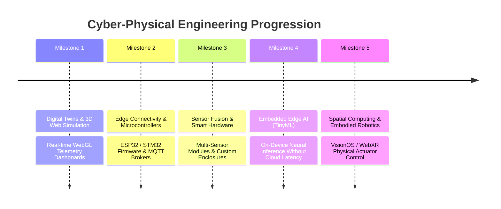

# 08. Cyber-Physical & Electronic Engineering Roadmap

## 1. Bridging Software into Physical Reality

PRODE leverages the Founder's **Electronic Engineering** degree to establish a hard competitive barrier that pure software agencies cannot cross: the seamless integration of digital user interfaces, AI models, and real-time physical electronics.

---

## 2. Milestone Specifications

### Milestone 1: Digital Twins & WebGL Telemetry (Near Term)
* **Objective:** Render high-fidelity 3D digital twins of physical hardware in the browser and animate them using live synthetic or real telemetry.
* **Technology:** Three.js, React Three Fiber, GLTF models, WebSockets.
* **Commercial Applications:** Industrial machinery monitoring dashboards, interactive product manuals, smart facility digital twins.

### Milestone 2: Microcontroller Firmware & Edge Telemetry (Mid Term)
* **Objective:** Establish robust, bidirectional communication between embedded hardware and cloud infrastructure.
* **Technology:** ESP32-S3 microcontrollers, FreeRTOS, C++, MQTT brokers, TLS client certificates.
* **Core Capabilities:**
  * Sub-50ms sensor telemetry streaming over Wi-Fi and Bluetooth Low Energy (BLE).
  * Over-the-air (OTA) firmware update pipelines.
  * Fail-safe offline state caching and automated reconnection logic.
* **Commercial Applications:** Smart agriculture sensors, cold-chain temperature monitors, smart-home automation hubs.

### Milestone 3: Hardware Sensor Fusion & Rapid Prototyping
* **Objective:** Design and assemble physical prototype units combining multiple environmental, motion, and acoustic sensors.
* **Technology:** KiCad schematic design, breadboard/perfboard prototyping, 3D printed enclosures, I2C / SPI sensor buses.
* **Sensor Arrays:** Accelerometers/gyroscopes (IMU), infrared thermopiles, optical particulate sensors, ambient light/color sensors.
* **Commercial Applications:** Predictive maintenance sensor pucks, smart retail inventory shelves, environmental monitoring enclosures.

### Milestone 4: Embedded Edge AI (TinyML)
* **Objective:** Run lightweight neural network inference directly on low-power microcontrollers without cloud dependency or latency.
* **Technology:** TensorFlow Lite for Microcontrollers (TFLM), Edge Impulse, ESP-NN optimizations.
* **Capabilities:**
  * Real-time acoustic anomaly detection (bearing failure, motor stress).
  * Gesture recognition from low-resolution radar or optical sensors.
  * Local voice wake-word detection with zero network latency and complete privacy.
* **Commercial Applications:** Privacy-first smart home sensors, industrial motor vibration analyzers.

### Milestone 5: Spatial Computing & Embodied Robotics
* **Objective:** Enable spatial computing headsets (Apple Vision Pro, Meta Quest) and browser WebXR environments to directly manipulate physical actuators and robotic arms.
* **Technology:** WebXR, ROS2 (Robot Operating System), serial/Ethernet actuator controllers.
* **Commercial Applications:** Remote tele-operation interfaces, spatial robotic programming, interactive museum/retail installations.

---

## 3. Hardware Safety & Prototyping Rules

1. **Simulate Before Assembling:** Schematics, pinouts, and voltage tolerances must be validated in simulation tools (SPICE, Wokwi) before physical power is applied.
2. **Galvanic Isolation:** High-voltage or inductive loads (relays, motors) must be optically or magnetically isolated from sensitive microcontroller logic.
3. **Fail-Closed Actuation:** Any failure in network connectivity or sensor telemetry must automatically command physical actuators to a safe, neutral state.
