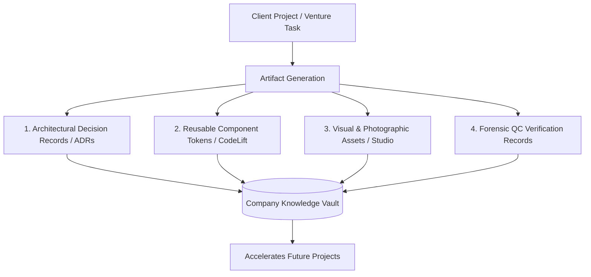

# 09. Knowledge & Artifact Management System

## 1. Principles of Institutional Memory

PRODE treats documentation, design tokens, and engineering artifacts as persistent company assets. Every client build, internal prototype, and architectural decision must be preserved in a structured, immutable format to continuously train internal systems and accelerate future deliveries.

---

## 2. Artifact Taxonomies & Storage Protocols

| Artifact Category | Format & Storage | Preservation Rules | Access Scope |
| :--- | :--- | :--- | :--- |
| **Architectural Decisions (ADR)** | Markdown in `docs/adr/` | Immutable; updates require new ADR referencing the prior. | Public / Team |
| **Component Libraries** | TypeScript / React in `packages/ui` | Strict semantic versioning; must pass `codelift` linting. | Internal / Client |
| **Visual Production Briefs** | Markdown + PNGs in `assets/` | Stored alongside prompt metadata and camera parameters. | Private Vault |
| **Forensic Reality QC Logs** | Markdown checklists | Logged per release milestone; permanent record. | Client & Internal |
| **Client SOWs & Milestones** | Signed PDFs in secure vault | Financial records maintained indefinitely. | Restricted Executive |

---

## 3. Architectural Decision Record (ADR) Protocol

Any significant technical decision—such as adopting a new database, choosing a communications protocol, or refactoring a core module—must be documented using an ADR.

### Standard ADR Structure
1. **Title:** Short, numbered description (e.g., `ADR-001: Selection of Prisma ORM over Drizzle`).
2. **Context:** What technical problem or business constraint prompted this decision?
3. **Decision:** Exactly what technology, framework, or architectural pattern was chosen?
4. **Status:** Proposed, Accepted, Deprecated, or Superseded.
5. **Consequences:** Positive benefits, negative trade-offs, and mitigation strategies.

---

## 4. Evidence Policy & Anti-Hallucination

In alignment with the canonical [Sentinel Designer Brain Evidence Policy](https://github.com/zakshub/designer/blob/main/constitution/evidence-policy.md):
1. **No Speculative Citations:** Never cite non-existent documentation, fake benchmark numbers, or hallucinated API endpoints.
2. **Deterministic Code References:** All codebase references must cite verified file paths and line ranges.
3. **Traceability:** Every product requirement must trace directly to a verified customer need or strategic mandate.
