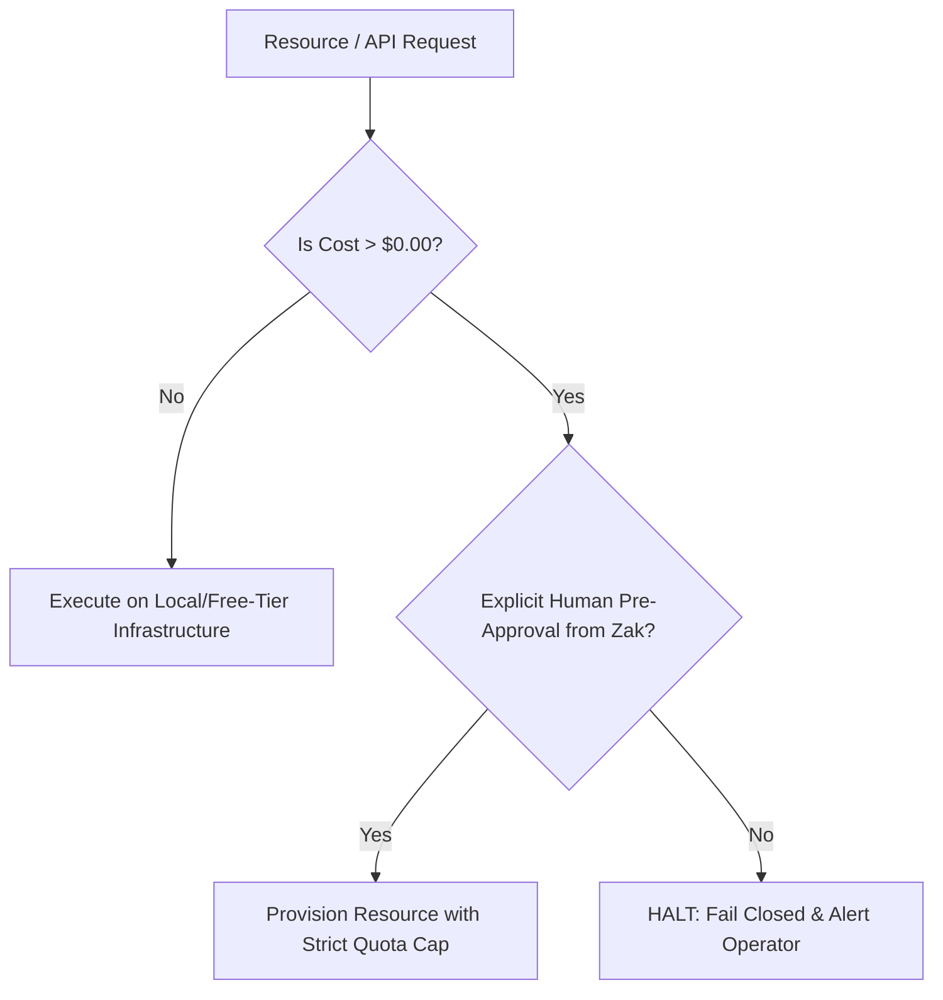

# 10. Financial & Risk Controls

## 1. Zero-Spend Financial Guardrails

PRODE enforces a strict **Zero-Authorized Spend Default** inspired by the core governance of [ZEDCU](https://github.com/zakshub/zedcu).



### Non-Negotiable Financial Policies
1. **Zero-Spend Default:** All development, testing, and continuous integration environments must run on local compute, open models, or verified free-tier quotas (Cloudflare Pages, Vercel Hobby, Render free, Neon free tiers).
2. **Paid API Lockout:** No autonomous agent or developer script may trigger billable external API endpoints (e.g., paid OpenAI models, AWS GPU instances) without Zak's prior written confirmation.
3. **Budget Caps per Milestone:** When paid resources are authorized for a client build, a hard budgetary spending cap is configured at the cloud provider level. If the spend cap is reached, services automatically throttle rather than billing excess charges.

---

## 2. Cash Flow & Revenue Safeguards

1. **The 50/25/25 Cash Flow Rule:**
   * **50% Upfront Deposit:** No project planning, architecture, or coding begins until 50% of the contract value is cleared in the bank.
   * **25% Milestone Payment:** Billed and collected upon demonstration of the verified interactive staging build.
   * **25% Final Acceptance:** Billed prior to production deployment and source code transfer.
2. **Hold on Source Code Ownership:**
   * All client contracts explicitly stipulate that intellectual property transfers occur **only after 100% of outstanding invoices are fully paid**.
   * Work product remains the sole property of PRODE until final settlement.

---

## 3. Client Isolation & Intellectual Property (IP) Ring-Fencing

```
   ┌────────────────────────────────────────────────────────┐
   │                  PRODE CORE INTELLECT                  │
   │  (Designer Brain, Studio QC, ZaxterLab, CodeLift)      │
   │  STATUS: Strictly Proprietary & Non-Transferable       │
   └──────────────────────────┬─────────────────────────────┘
                              │ Reusable Modules / Abstractions
                              ▼
   ┌────────────────────────────────────────────────────────┐
   │                  CLIENT DELIVERABLES                   │
   │  (Custom Frontend App, Specific Firmware, Schematics)  │
   │  STATUS: Transferred to Client Upon Final Settlement   │
   └────────────────────────────────────────────────────────┘
```

1. **Clear Division of Assets:**
   * **Client IP:** Custom database schemas, proprietary business logic, client-specific branding, and bespoke frontend views are transferred to the client upon full payment.
   * **PRODE Background IP:** Internal generator engines, agent prompt architectures, design systems, and reusable utility libraries remain the permanent intellectual property of PRODE. Clients receive an irrevocable, non-exclusive license to use the compiled output.
2. **Data Isolation Boundaries:**
   * Client data, customer records, and API secrets are strictly isolated in dedicated, encrypted environment vaults.
   * Client proprietary data is never used to train generalized models or shared across project sandboxes.

---

## 4. Security & Vulnerability Controls

1. **Fail-Closed Permissions:** Agent sessions and build scripts execute with least-privilege credentials. If permission is ambiguous, execution halts.
2. **Automated Secret Auditing:** Every commit is scanned for leaked tokens, private keys, and environment variables. If a secret is detected, the commit fails instantly.
3. **Dependency Scanning:** Third-party npm and pip packages are scanned for known vulnerabilities (CVEs) prior to production inclusion.
