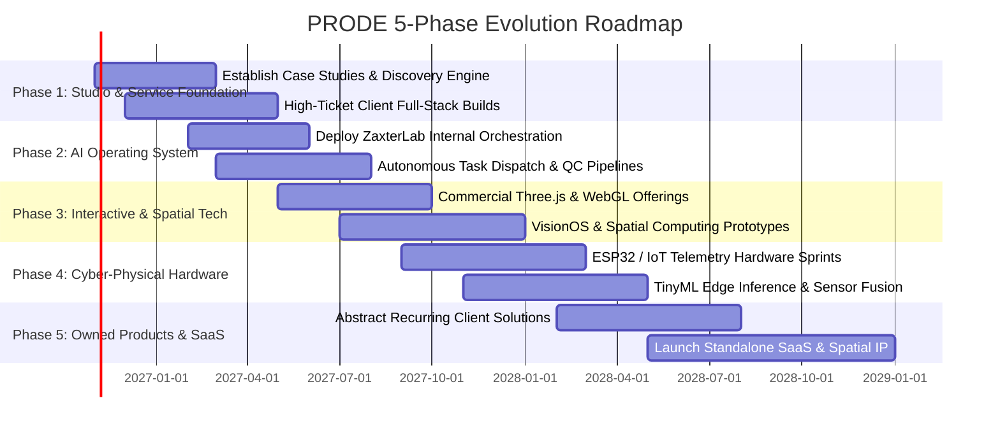

# 11. Implementation Roadmap & Capability Evolution

## 1. Master Strategic Timeline

The growth of PRODE follows five deliberate, self-funding phases. Each phase expands capabilities and increases revenue margins only after the preceding phase is commercially validated.

---

## 2. Phase-by-Phase Execution Milestones

### Phase 1 — Establish the Product Studio (Months 1–4)
* **Goal:** Prove the full-stack product engineering model, build compelling case studies, and generate robust operating cash flow.
* **Key Deliverables:**
  * Package the Sprint Zero architectural offering.
  * Deliver 3–5 high-ticket client builds combining Next.js, Tailwind, and Prisma.
  * Formalize the design-to-code pipeline using `zakshub/designer` and `zakshub/codelift`.
* **Exit Gate:** $50,000+ in cleared client contract revenue and 3 verified public case studies.

### Phase 2 — Build the AI Operating System (Months 3–6)
* **Goal:** Productionize [ZaxterLab](https://github.com/zakshub/zaxterlab) as the internal operating engine for PRODE.
* **Key Deliverables:**
  * Implement automated task decomposition and multi-agent dispatch (Sirfaraz model).
  * Build the dual-gate QC automation engine (CodeLift AST compiler check + Studio forensic reality review).
  * Deploy persistent artifact archiving and token spend tracking.
* **Exit Gate:** 50% reduction in delivery sprint cycle times without increase in defects.

### Phase 3 — Specialize in Interactive & Spatial Products (Months 6–9)
* **Goal:** Establish undeniable market dominance in cinematic real-time 3D, WebGL, and spatial computing.
* **Key Deliverables:**
  * Package productized 3D configurators and cinematic landing experiences via `zakshub/bob`.
  * Deliver interactive WebGL experiences running at consistent 60 FPS on mobile.
  * Develop proof-of-concept spatial computing applications for WebXR and Apple VisionOS.
* **Exit Gate:** Securing premium interactive 3D contracts commanding >$15,000 per build.

### Phase 4 — Develop Cyber-Physical & Hardware Capabilities (Months 9–14)
* **Goal:** Bridge digital products into physical hardware, microcontrollers, and edge sensors.
* **Key Deliverables:**
  * Prototype ESP32-S3 IoT telemetry hubs streaming data to real-time WebGL digital twins.
  * Deploy on-device TinyML inference models for acoustic and vibration anomaly detection.
  * Design custom circuit schematics, PCB prototypes, and 3D printed enclosures.
* **Exit Gate:** Delivering a fully integrated cyber-physical product client contract with hardware and cloud sync.

### Phase 5 — Launch Proprietary Owned Products (Months 14+)
* **Goal:** Build enduring recurring subscription revenue (ARR) and enterprise valuation.
* **Key Deliverables:**
  * Abstract the most repeated client problem into a standalone SaaS platform.
  * Launch self-serve enterprise pricing tiers backed by automated onboarding.
  * Reinvest client services cash flow into proprietary product R&D with zero external equity dilution.
* **Exit Gate:** Reaching $10,000/month in recurring software revenue (MRR) independent of active client hours.
