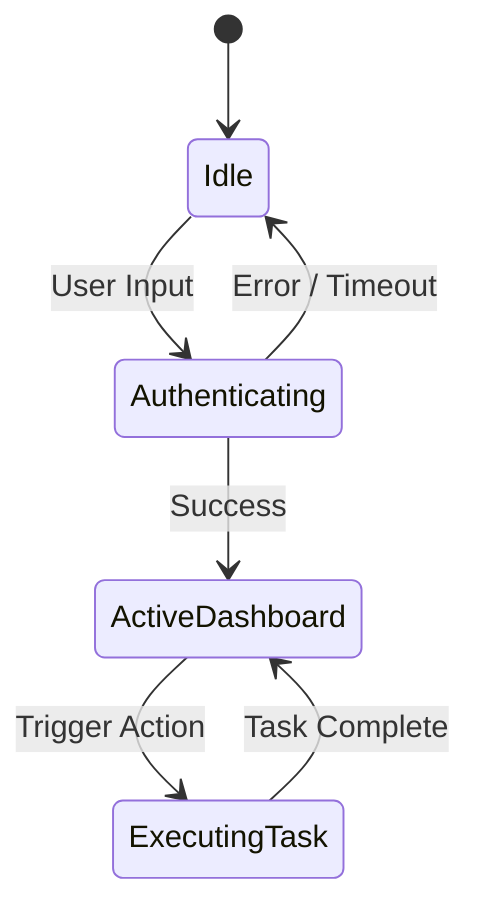

# Product Requirement Document (PRD)

**Product Name:** [Insert Product Name]  
**Version:** 1.0.0  
**Status:** [Draft / Under Review / Approved / In Engineering / Released]  
**Author:** [Product Architect]  
**Governing Intelligence:** `zakshub/designer`, `zakshub/studio`, `zakshub/codelift`

---

## 1. Product Overview & Core Objective
* **Target Users:** [Who is the primary operator or customer?]
* **Core Problem Statement:** [What specific pain point is being resolved?]
* **Value Proposition:** [Why does this solution win over existing alternatives?]

---

## 2. User Journeys & State Machines
* **Primary User Flow:** Step-by-step path from entry to value realization.
* **State Machine Diagram:**

---

## 3. UX/UI & Accessibility Specification (`zakshub/designer`)
* **Design System Reference:** [List token palette, typography scale, spacing matrix].
* **Accessibility Level:** W3C WCAG 2.1 AA Compliance required.
* **Component Inventory:**
  * Header & Navigation Bar
  * Data Visualization Viewport (WebGL or Charting)
  * Action Control Drawer / Modal

---

## 4. Visual Assets & Realism Brief (`zakshub/studio`)
* **Asset Requirements:** [List required images, textures, 3D models].
* **Physical Causality Rules:**
  * Light vector coordinates defined.
  * Contact shadows and material roughness parameters locked.
  * Anti-AI realism verification mandatory.

---

## 5. Technical Requirements & API Contracts (`zakshub/codelift`)
* **Frontend Tech:** Next.js (App Router), TypeScript, Tailwind CSS.
* **Backend Tech:** Node.js, Prisma ORM, PostgreSQL.
* **Hardware & Protocols (if applicable):** ESP32 microcontroller, MQTT broker.
* **Non-Functional Performance Targets:**
  * Core Web Vitals: Largest Contentful Paint (LCP) < 1.8s.
  * WebGL Frame Rate: Solid 60 FPS on mobile devices.
  * API Response Latency: < 150ms at p95.

---

## 6. Acceptance Criteria
* [ ] All interactive flows match Figma/wireframe specifications.
* [ ] Zero TypeScript compilation warnings or errors (`tsc --noEmit`).
* [ ] Pass automated accessibility audit (axe-core / Lighthouse).
* [ ] Forensic reality QC approved by Studio auditor.
* [ ] Human sign-off completed by Zak.
